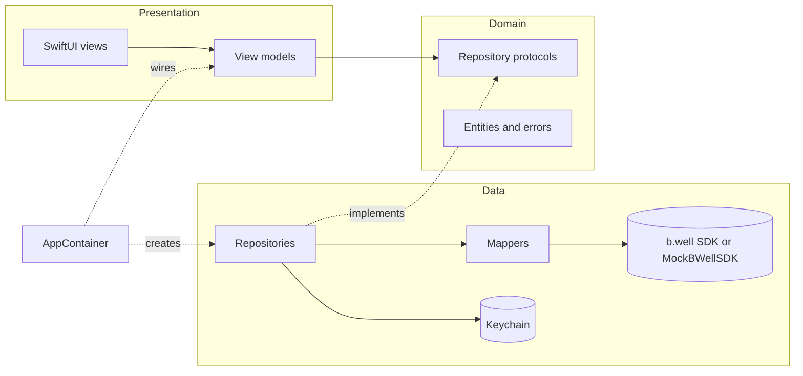

# b.well Health: iOS

[](https://github.com/a-ivanvillanueva/bwell-ios-sample-app/actions/workflows/ios.yml)


A SwiftUI app for viewing personal health records: sign in, browse your clinical data, manage the providers you are connected to, and edit your profile.

## About this project

This is an **improved version of a sample app I built at b.well** to show how to integrate their iOS SDK. The original worked, but it was tightly coupled to the SDK and had no tests. I rebuilt it as a portfolio piece to show how I approach a real codebase:

- **Clean Architecture and SOLID**, with a strict dependency rule that CI enforces.
- **A redesigned UI** that follows Apple's Human Interface Guidelines: tab bar, large titles, native sheets, skeleton loading and clear error states.
- **Tests** for view models, mappers, repositories and navigation.

> **All data is mocked.** The b.well SDK is private, so this repo ships `MockBWellSDK`, a small local Swift package that mirrors the parts of the SDK the app uses and returns **fictional** data. No network calls, no accounts and no real health information.

## Screenshots

<!--
  Add images to docs/screenshots/ and keep or edit the table below.
  Suggested: sign in, home, health summary, record detail, connections, profile.
-->

| Sign in | Home | Health |
|:---:|:---:|:---:|
|  |  |  |

| Record detail | Connections | Profile |
|:---:|:---:|:---:|
|  |  |  |

## Features

- **Sign in** with an API key, then email and password or an OAuth token. Sessions are restored on relaunch.
- **Health summary** across nine categories (allergies, conditions, medications, labs and more), with drill-down to groups, records and a detail sheet.
- **Connections:** list, disconnect and delete; add a connection by searching for a provider, accepting a disclaimer and signing in on the provider's website.
- **Profile:** view and edit personal details, contact information and address.
- **Loading and errors:** skeleton placeholders while data loads, and friendly messages for offline, rejected keys and failed saves.

## Tech stack

| Area | Choice |
|---|---|
| Language and UI | Swift 5, SwiftUI, `async`/`await` |
| Architecture | Clean Architecture, MVVM, manual dependency injection |
| Navigation | `TabView` with a `NavigationStack` per tab, typed routes |
| Reactive state | Combine (session state) |
| Storage | iOS Keychain (Security framework) |
| Logging | `os.Logger` |
| Localization | String Catalogs |
| Testing | Swift Testing, hand-written fakes |
| CI | GitHub Actions: architecture check, build and test |
| Requirements | Xcode 16.4+, iOS 18.5+, iPhone and iPad |

## Architecture

Three layers and a composition root. **Dependencies point inward:** Presentation and Data both depend on Domain, and Domain depends on nothing.



| Layer | Responsibility |
|---|---|
| **Domain** | The app's own entities, errors and the protocols it needs (`SessionRepository`, `HealthRecordRepository`, ...). No SDK or UI imports. |
| **Data** | Implements those protocols with the SDK and Keychain, and maps SDK types to domain entities. The only layer that may `import BWellSDK`. |
| **Presentation** | SwiftUI views and view models. They know only domain protocols and entities. |
| **App** | `AppContainer` is the composition root: the one place that creates concrete objects. No singletons. |

```text
bwell-swift-ios/
├── MockBWellSDK/            Local package standing in for the private SDK
├── bwell-swift-ios/
│   ├── App/                 AppContainer (composition root)
│   ├── Domain/              Entities, errors, repository protocols
│   ├── Data/                SDK provider, repositories, mappers, Keychain
│   ├── Presentation/        Views and view models, grouped by feature
│   └── Utils/               Router, logging, reusable views, localizables
└── bwell-swift-iosTests/    Unit and integration tests
```

Worth a look: `AppContainer`, `BWellSessionRepository` (session rules and retry), `HealthRecord+BWell` (all SDK-to-domain mapping in one file), `LoadableViewModel` (one generic view model reused by several screens) and `NavigationRouter` (tab and path state).

## Testing and CI

Unit tests cover the view models, mappers, typed errors, router and `LoadableViewModel`, using fakes. Integration tests run the real repositories against the mock SDK. GitHub Actions runs two checks on every push:

1. **Architecture check:** fails if `import BWellSDK` appears outside `Data/`.
2. **Build and test** on a macOS runner.

Run the tests locally with **⌘U** in Xcode.

## Getting started

```bash
git clone https://github.com/a-ivanvillanueva/bwell-ios-sample-app.git
cd bwell-ios-sample-app
open bwell-swift-ios/bwell-swift-ios.xcodeproj
```

Select the **bwell-swift-ios** scheme and an iPhone simulator, then press **⌘R**. The mock accepts any non-empty API key and credentials (for example `demo-key`, then any email and password).

## Roadmap

- [ ] `@Observable` in place of `ObservableObject`
- [ ] Swift 6 language mode with strict concurrency
- [ ] Finish localization with String Catalogs
- [ ] Put the Keychain behind a protocol so the session repository can be tested without it
- [ ] UI tests for the main flows

## About the author

**Ivan Villanueva**: iOS engineer with almost five years of experience, most recently Senior iOS Developer.

- LinkedIn: [www.linkedin.com/in/a-ivanvillanueva]
- Email: [ivanvillanueva99@outlook.com]

## License and acknowledgements

Released under the **Apache License 2.0** (see [`LICENSE`](LICENSE)). The project started from the iOS example in b.well's public SDK examples repository; the architecture, redesign, tests, CI and mock SDK are my own work. **b.well** and its logo are trademarks of their owners. This project is not affiliated with or endorsed by b.well, and the bundled mock SDK is not the real one.
